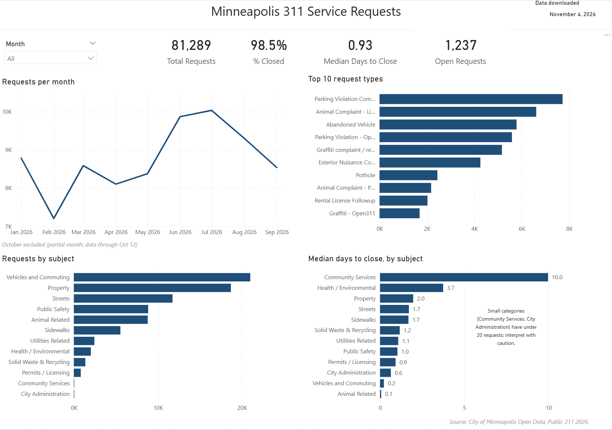
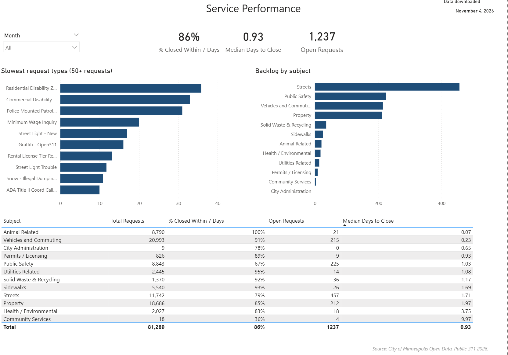

# Minneapolis 311 Service Requests Dashboard (2026)

A two-page Power BI dashboard that looks at how the City of Minneapolis handles 311 service requests: what residents report, how quickly cases get closed, and where open cases are piling up.

**Tools:** Power BI Desktop, Power Query, DAX
**Data:** [City of Minneapolis Open Data, Public 311 2026](https://opendata.minneapolismn.gov/) (downloaded November 4, 2026; records run from January 1 to October 12, 2026)

## Dashboard preview

| Overview | Service Performance |
|---|---|
|  |  |

## What the dashboard answers

**Overview page**
- How many requests came in, and what share have been closed?
- What is the typical time to close a request?
- How does volume change month to month?
- Which request types and subjects are the most common, and how fast does each subject close?

**Service Performance page**
- Which request types take the longest to close (types with 50 or more requests)?
- Where is the open backlog concentrated?
- How does each subject compare on volume, speed, and backlog?

## Key findings

- **81,289 requests** were logged between January 1 and October 12, 2026. **98.5%** are closed, and the **median time to close is 0.93 days**.
- Monthly volume peaks in July (about 10,000 requests) and is lowest in February (about 7,200).
- **Streets has the largest backlog:** 457 of the 1,237 open requests (about 37%), even though its median close time is only 1.7 days.
- **Public Safety has the lowest share closed within a week among the large categories:** 67% of its closed requests were closed within 7 days, compared with 79% to 100% for the other large subjects. Its median time to close (1.0 days) is not unusually slow, so the gap comes from a longer tail of cases that run past a week.
- **Vehicles and Commuting is the largest subject** (about 21,000 requests) and closes fast, with a median of 0.2 days.
- The slowest request types with 50 or more requests are mostly permit, inspection, and ADA-style workflows. These take weeks by design, so they should not be compared directly with something like a pothole report.

## How it was built

**Data preparation (Power Query)**
- Removed one duplicate case ID.
- Converted `CASEID` to text, since it is an identifier and not a number.
- Converted the opened and closed timestamps from text to date/time. The source labels them as UTC (`+00`), but the activity pattern (most requests opened between 8am and 4pm) shows they are local Minneapolis time, so I removed the suffix instead of converting time zones.
- Replaced the 0/1 status code with readable labels (0 = Closed, 1 = Open). I confirmed the mapping by checking that every closed case has a closed date and every open case does not.
- Added a `Resolution Days` column (null for open cases) and an `Opened Date` column.
- Dropped redundant columns (the title duplicated the request type on every row) and the coordinate columns.
- Renamed columns to plain-language names.

**Data model (DAX)**
- A calendar table related to the opened date (one-to-many, single direction).
- Measures for total, closed, and open requests, percent closed, median days to close, percent closed within 7 days, and a prior-month comparison.
- Median is used instead of average because resolution time is heavily skewed (median 0.93 days, mean 3.85 days, 99th percentile about 41 days).

## Decisions and limitations

- **October is excluded from the monthly trend** because the data ends October 12 and a partial month would look like a sudden drop.
- **Location data is not mapped.** The coordinates are projected (Web Mercator) values, not latitude and longitude, and about 24% of rows have no location at all.
- **"Closed" is a system status.** A closed date reflects when the case was closed in the 311 system, which is not always when the underlying issue was fixed. Very fast medians (for example, Animal Related at 0.1 days) may partly reflect quick administrative closure.
- **Percent closed within 7 days** is calculated over closed requests only, so it is an upper bound. Cases still open are not counted against it. The 7-day window is my own benchmark, not an official city target.
- **Small categories** (Community Services with 18 requests, City Administration with 9) show dramatic numbers on very small samples and should be read with caution.
- Request types on the slowest-types chart are limited to those with at least 50 requests, for the same reason.

## Files

- `MN_311_Portfolio_Dash.pbix`: the Power BI report (open with the free Power BI Desktop)
- `MN_311_Portfolio_Dash.pdf`: a static export of both dashboard pages
- `images/`: page screenshots used above

The raw data is not included. It is available from the City of Minneapolis Open Data portal linked above.
